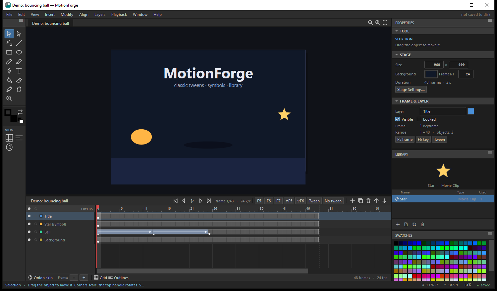
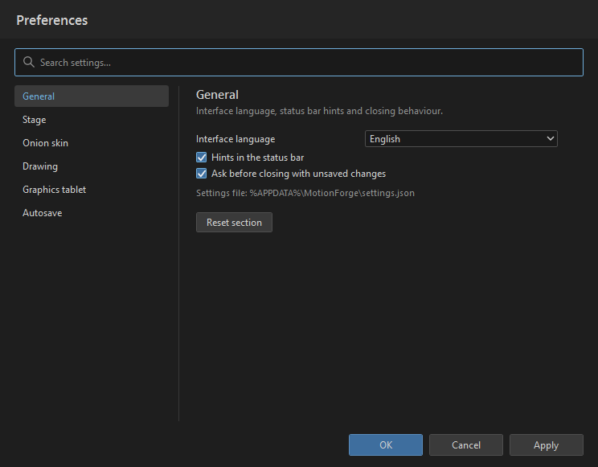
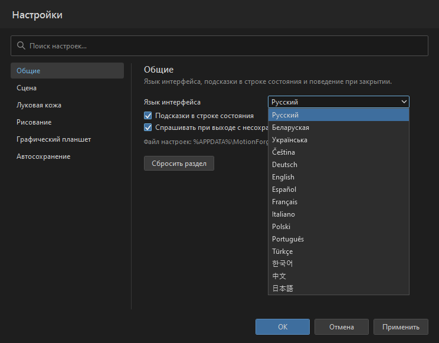
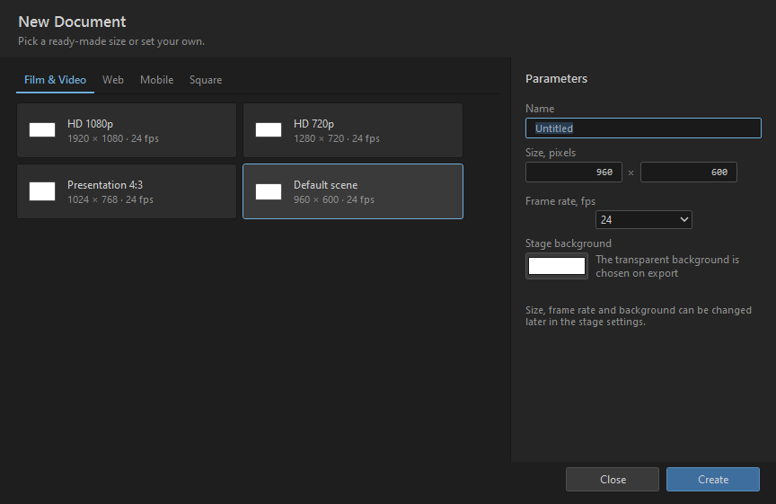

# MotionForge

**English** · [Русский](#russian)

**Desktop 2D animation studio for Windows.** Timeline with keyframes and classic tweens, layers,
symbols and a library, vector drawing, and export to GIF, PNG sequences, sprite sheets and SVG.

Written from scratch in **C# / .NET 10 (WPF)**. No external dependencies, no NuGet packages and
no third-party libraries — only the base .NET assemblies. MIT licensed.



---

## Features

### Animation
* **Timeline** with a frame ruler, keyframes, ranges and a draggable playhead.
* **Classic tweens** between keyframes with easing; a tween lives on the destination keyframe
  and animates the span from the previous one — like in familiar editors.
* **Layers**: visibility, lock, colour, rename, reorder, duplicate.
* **Symbols (clips)** and a library with previews; enter a symbol and return to the scene.
* **Onion skin** (faint neighbouring frames), grid and outline mode.
* Insert and remove frames, blank frames and keyframes, delete a keyframe.

### Drawing
* Tools: selection, subselection (nodes), free transform, line, rectangle, ellipse, pencil, brush,
  pen (curves), text, fill, eraser, eyedropper, hand (pan), zoom.
* Colour: fill and stroke, stroke width, a 216-colour web-safe palette, default swatches, quick
  swap and reset.
* Colour picker with an **HSV wheel** (hue by angle, saturation by radius), brightness, R/G/B
  sliders with gradients, numeric fields and HEX input; the colour is applied when the mouse is
  released, so dragging does not flood the undo history.
* Text with font, size, weight and alignment.
* Grouping, stacking order, flip, rotate, align and distribute objects.
* Snap to grid, modifier keys while drawing (Shift/Alt).
* Smooth freehand strokes: the path is fitted with a Catmull-Rom curve, and pressure profiles are
  drawn as a continuous ribbon, so a line never breaks apart where it crosses itself.
* Images: `Ctrl+I` imports a file; `Ctrl+V` pastes a screenshot or an image copied in Explorer, and
  repeated pastes cascade instead of covering each other.

### Application
* **Undo/redo** (snapshot history, up to 90 steps).
* **Command palette** (`Ctrl+K`) with search across every action.
* **New document** (`Ctrl+N`): ready-made stage sizes by category (film, web, mobile, square),
  frame rate and background colour.
* **Settings** (`Ctrl+,`): sections with search, like the Windows Settings app — interface
  language, grid, onion skin, drawing, graphics tablet, autosave. Stored in
  `%APPDATA%\MotionForge\settings.json`.
* **Graphics tablet**: pen input is handled separately from the mouse, pressure sets the stroke
  width (WPF `StylusPoint.PressureFactor`), the eraser end of the stylus erases, and finger
  touches can be ignored (palm rejection).
* **Interface languages**: Russian and English are complete; 13 more (Belarusian, Ukrainian,
  German, French, Spanish, Italian, Portuguese, Polish, Czech, Turkish, Chinese, Japanese,
  Korean) cover menus, panels and dialogs, with English as the fallback. A new language is a
  single JSON file.
* Dockable layout: panels can be hidden and resized with splitter bars.
* Autosave and session recovery, dark theme, status bar with coordinates.
* Built-in **self-test** (`--selftest`): 118 checks covering the core, geometry, undo, save and
  load, localisation, settings and every exporter.

### Export

| Format | Result |
| --- | --- |
| `GIF` | animated GIF with correct per-frame delays |
| `PNG` | a single frame (transparent if needed) |
| `PNG sequence` | `frame_0001.png`, `frame_0002.png`, … |
| `Sprite sheet` | one frame grid `_sheet.png` plus an atlas `_sheet.xml` |
| `SVG` | vector storyboard of the scene |

The sprite-sheet XML uses the Starling/Sparrow `TextureAtlas` format, which Phaser, PixiJS,
Unity plugins and other engines read out of the box: every frame is a `<SubTexture>` with its
name and pixel rectangle, and the sheet size and frame rate are on the root element.

---

## Settings, tablet and languages



The **Edit → Settings…** dialog (`Ctrl+,`) keeps everything in one place:

| Section | What you can change |
| --- | --- |
| General | interface language, status bar hints, asking before closing with unsaved changes |
| Stage | grid, grid step, snap new shapes to the grid, outline-only view |
| Onion skin | on/off, how many frames before and after |
| Drawing | default stroke width, brush size, stroke smoothing |
| Graphics tablet | pen separate from the mouse, pressure → stroke width, ignore finger touches |
| Autosave | interval in minutes (`0` turns it off) |

The window follows the Windows Settings pattern: sections on the left, a search field on top,
the selected section's fields on the right plus a "Reset section" button. The buttons at the
bottom are OK (apply and close), Cancel and Apply (apply without closing). Everything applies
immediately except the language, which applies on OK — otherwise the whole interface would have
to be rebuilt while the modal dialog is open. The file `%APPDATA%\MotionForge\settings.json` is
plain JSON and its values are validated on load.

**First run.** If there is no settings file yet, MotionForge picks the Windows UI language when
a translation exists and falls back to Russian otherwise.

**Tablet.** Pen input arrives through its own path (`OnStylusDown/Move/Up`), so drawing does not
interfere with the mouse. Pressure (`StylusPoint.PressureFactor`) becomes a width profile: every
point of the stroke gets its own width, and the line is drawn as a single ribbon (including after
path simplification). The eraser end of the stylus erases, finger touches can be disabled.

**Languages.** A translation key is the Russian string from the source code, so a new language is
a single file:



```jsonc
// Localization/xx.json
{
  "@name": "My language",   // how it is named in the settings list
  "Файл": "…",
  "Правка": "…"
}
```

Copy the file into the `Localization` folder next to `MotionForge.exe` — the language appears in
the list immediately, no rebuild required. Missing strings fall back to English, then to the
original Russian, so a translation can be done in parts. The `"@name"` key is optional; without
it the built-in name or the file code is used.

Export the template with every UI string:

```powershell
dotnet run -c Release -- --lang-template
```

Complete sets: `ru` (built in) and `en` (591 strings); `be`, `uk`, `de`, `fr`, `es`, `it`, `pt`,
`pl`, `cs`, `tr`, `zh`, `ja`, `ko` cover menus, panels, settings and dialog titles.

---

## New document



`Ctrl+N` opens the document dialog: ready-made sizes by category on the left, and name, width,
height in pixels, frame rate and background colour on the right. A preset fills in size, frame
rate and background; any field can still be edited by hand.

| Category | Presets |
| --- | --- |
| Film & Video | HD 1080p, HD 720p, Presentation 4:3, Default scene 960 × 600 |
| Web | Banner 728 × 90, Cover 1200 × 630, Poster 1080 × 1350 |
| Mobile | Vertical 1080 × 1920, Story 1080 × 1920 (15 fps), iPhone 390 × 844 |
| Square | 1080 × 1080, 720 × 720, Mini 512 × 512 |

"Create" makes a new project with one layer, "Close" changes nothing. Size, frame rate and
background can be changed later in the Stage panel.

---

## Requirements

* Windows 10 or 11 (x64)
* [.NET SDK 10](https://dotnet.microsoft.com/download) — to build from source
* [.NET Desktop Runtime 10](https://dotnet.microsoft.com/download) — to run a prebuilt copy

## Build and run

```powershell
git clone https://github.com/VaKaVo/MotionForge.git
cd MotionForge

# build and run from source
dotnet run -c Release

# or build, then start the exe
dotnet build -c Release
.\bin\Release\net10.0-windows\MotionForge.exe
```

Ready-to-ship folder:

```powershell
dotnet publish -c Release -r win-x64 --self-contained false -o publish
```

## Self-test

```powershell
dotnet run -c Release -- --selftest
```

The report is written to `%TEMP%\motionforge-selftest.txt`; exit code `0` means every check
passed. CI runs the same command (see `.github/workflows/build.yml`).

Development and documentation flags:

| Flag | Action |
| --- | --- |
| `--selftest` | run the checks and exit |
| `--lang-template` | dump every UI string into a translation template and exit |
| `--prefs` | open the settings window right after launch (handy for screenshots) |
| `--newdoc` | open the New Document window right after launch |

## Keyboard

| Action | Keys |
| --- | --- |
| New / open / save / save as | `Ctrl+N` / `Ctrl+O` / `Ctrl+S` / `Ctrl+Shift+S` |
| Import image / export | `Ctrl+I` / `Ctrl+E` |
| Undo / redo | `Ctrl+Z` / `Ctrl+Y` |
| Copy / cut / paste / duplicate / delete | `Ctrl+C` / `Ctrl+X` / `Ctrl+V` / `Ctrl+D` / `Delete` |
| Paste a screenshot or image file | `Ctrl+V` |
| Select all / deselect | `Ctrl+A` / `Ctrl+Shift+A` |
| Group / ungroup | `Ctrl+G` / `Ctrl+Shift+G` |
| Convert to symbol / enter / exit | `F8` / double click / `Ctrl+↑` |
| Bring to front / send to back | `Ctrl+Shift+↑` / `Ctrl+Shift+↓` |
| Send backward / bring forward | `Alt+↓` / `Alt+↑` |
| Insert frame / remove frame | `F5` / `Shift+F5` |
| Keyframe / blank keyframe / clear key | `F6` / `F7` / `Shift+F6` |
| Create classic tween | `F9` |
| New layer / layer up / layer down | `Ctrl+Shift+N` / `Ctrl+Alt+↑` / `Ctrl+Alt+↓` |
| Zoom in / out / 100% / fit stage | `Ctrl++` / `Ctrl+-` / `Ctrl+1` / `Ctrl+0` |
| Grid / outlines / onion skin | `Ctrl+'` / `Ctrl+Shift+O` / `Alt+O` |
| Play-pause / go to start / go to end | `Space` / `Home` / `End` |
| Previous / next frame | `,` / `.` |
| Panels: tools / properties / library | `Ctrl+F2` / `Ctrl+F3` / `Ctrl+L` |
| Settings / command palette / hotkeys | `Ctrl+,` / `Ctrl+K` / `F1` |

Tools switch with a single letter: `V` selection, `A` nodes, `Q` free transform, `N` line,
`R` rectangle, `O` ellipse, `Y` pencil, `B` brush, `P` pen, `T` text, `K` fill, `E` eraser,
`I` eyedropper, `H` hand, `Z` zoom.

> While the cursor is in a text field, single letters do not switch tools — only `Ctrl` combos
> for file operations and the command palette still work.

## Project files

A project is saved as `.mforge` — readable JSON (scenes, layers, keyframes, symbols, library).
A plain `.json` file works as well.

Autosave: `%APPDATA%\MotionForge\autosave.mforge`. If the app was closed unexpectedly, the next
launch offers to restore the session.

## Repository structure

```
MotionForge/
├─ App.xaml, App.xaml.cs         entry point, global error handling
├─ MainWindow.xaml(.cs)          shell: menus, docks, timeline, hotkeys
├─ Theme.xaml                    dark theme and control templates
├─ Model/                        document model (no WPF): geometry, elements,
│                                timeline, Store (edits, undo, selection)
├─ Services/                     commands, exporters, renderer, icons, self-test
├─ Tools/                        drawing and selection tools
├─ Views/                        stage, timeline, panels, dialogs, UI helpers
├─ Localization/                 translation tables (en.json, de.json, fr.json, …)
├─ Assets/app.ico                application icon
└─ docs/                         screenshots of the app, settings and new document
```

The document model does not depend on WPF: it can be used in tests and console scenarios
(that is how `--selftest` works).

## Current limitations

* Video files (MP4/WebM) are not exported directly: use a PNG sequence and any external encoder
  (for example ffmpeg) — that keeps full control over quality.
* Classic tweens are supported (position, scale, rotation, alpha); shape tweens and nested
  symbol animation are planned.
* No audio or camera yet.
* The app targets Windows; the document model is cross-platform, but the UI is WPF.

## License

[MIT](LICENSE).

## Disclaimer

MotionForge is an independent open-source project. It is not affiliated with Adobe and does not
use Adobe code, assets or icons. Adobe and Adobe Animate are trademarks of Adobe Inc. Format
names (GIF, PNG, SVG) belong to their respective owners and are mentioned only to describe
compatibility.

---

<a id="russian"></a>
# MotionForge — по-русски

[English](#motionforge) · **Русский**

**Настольная студия 2D-анимации для Windows.** Таймлайн с ключевыми кадрами и классическими
переходами, слои, символы и библиотека, векторное рисование, экспорт в GIF, PNG-секвенцию,
спрайт-лист и SVG.

Написана с нуля на **C# / .NET 10 (WPF)**. Никаких внешних зависимостей, NuGet-пакетов
и сторонних библиотек — только базовые сборки .NET. Лицензия MIT.

---

## Возможности

### Анимация
* **Таймлайн** с линейкой кадров, ключевыми кадрами, диапазонами и перетаскиваемым маркером
  воспроизведения.
* **Классические переходы (твины)** между ключевыми кадрами с плавностью (easing); переход
  хранится на конечном ключевом кадре и анимирует промежуток от предыдущего — как в привычных
  редакторах.
* **Слои**: видимость, блокировка, цвет, переименование, перестановка, дублирование.
* **Символы (клипы)** и библиотека с предпросмотром, вход в символ и выход из него.
* **Луковая кожа** (полупрозрачные соседние кадры), сетка и режим контуров.
* Вставка/удаление кадров, пустые и ключевые кадры, удаление ключа.

### Рисование
* Инструменты: выделение, частичное выделение (узлы), свободное трансформирование, линия,
  прямоугольник, овал, карандаш, кисть, перо (кривые), текст, заливка, ластик, пипетка,
  рука (панорама), масштаб.
* Работа с цветом: заливка и обводка, толщина, палитра из 216 веб-безопасных образцов,
  образцы по умолчанию, быстрый обмен/сброс цветов.
* Палитра с **цветовым кругом HSV** (оттенок — угол, насыщенность — радиус), яркостью,
  ползунками R/G/B с градиентами, числовыми полями и вводом HEX; цвет применяется при
  отпускании мыши, поэтому перетаскивание не засоряет историю отмены.
* Текст с выбором шрифта, размера, начертания и выравнивания.
* Группировка, порядок наложения, отражение, поворот, выравнивание и распределение объектов.
* Привязка к сетке, автодополнение помощников при рисовании (Shift/Alt).
* Ровные росчерки: линия сглаживается кривой Catmull-Rom, а профиль нажима рисуется сплошной
  «лентой» — штрих не разрывается там, где он пересекает сам себя.
* Изображения: `Ctrl+I` импортирует файл, `Ctrl+V` вставляет скриншот или картинку, скопированную
  в проводнике; повторные вставки идут каскадом и не ложатся друг на друга.

### Программа
* **Отмена/повтор** (история снимками, до 90 шагов).
* **Палитра команд** (`Ctrl+K`) с поиском по всем действиям.
* **Новый документ** (`Ctrl+N`): готовые размеры сцены по категориям (кино, веб, мобильные,
  квадрат), частота кадров и цвет фона.
* **Настройки** (`Ctrl+,`): разделы с поиском, как в «Параметрах» Windows — язык интерфейса,
  сетка, луковая кожа, рисование, графический планшет, автосохранение. Хранятся в
  `%APPDATA%\MotionForge\settings.json`.
* **Графический планшет**: перо обрабатывается отдельно от мыши, сила нажатия задаёт толщину
  линии (WPF `StylusPoint.PressureFactor`), перевёрнутое перо работает как ластик, касания
  пальцем можно игнорировать (защита от ладони).
* **Языки интерфейса**: русский и английский переведены полностью, ещё 13 языков
  (белорусский, украинский, немецкий, французский, испанский, итальянский, португальский,
  польский, чешский, турецкий, китайский, японский, корейский) — базовый набор панелей и
  меню, остальное подставляется из английского. Свой язык добавляется одним JSON-файлом.
* Настраиваемая раскладка: панели можно скрывать и перетаскивать (разделители между доками).
* Автосохранение и восстановление сессии, тёмная тема, статусная строка с координатами.
* Встроенная **самопроверка** (`--selftest`): 118 проверок ядра, геометрии, отмены,
  сохранения/загрузки, локализации, настроек и всех экспортёров.

### Экспорт
| Формат | Что получается |
| --- | --- |
| `GIF` | анимированный GIF с корректной задержкой кадров |
| `PNG` | один кадр (с прозрачностью при необходимости) |
| `PNG-секвенция` | `frame_0001.png`, `frame_0002.png`, … |
| `Спрайт-лист` | сетка кадров `_sheet.png` и описание `_sheet.xml` |
| `SVG` | векторная раскадровка сцены |

XML спрайт-листа — формат Starling/Sparrow (`TextureAtlas`), его читают Phaser, PixiJS,
плагины Unity и другие движки без конвертации: каждый кадр описан элементом `<SubTexture>`
с именем и пиксельным прямоугольником, а размер листа и частота кадров — в корневом элементе.

---

## Настройки, планшет и языки


Диалог **«Правка → Настройки…»** (`Ctrl+,`) собрал в одном месте всё, что раньше
приходилось держать в голове:

| Раздел | Что настраивается |
| --- | --- |
| Общие | язык интерфейса, подсказки в строке состояния, вопрос при выходе с несохранёнными правками |
| Сцена | сетка, шаг сетки, привязка новых фигур к сетке, показ только контуров |
| Луковая кожа | включение, сколько кадров до и после |
| Рисование | толщина линии, размер кисти, сглаживание линий |
| Графический планшет | перо отдельно от мыши, сила нажатия → толщина линии, игнорирование касаний пальцем |
| Автосохранение | интервал в минутах (`0` — выключить) |

Окно устроено как «Параметры» Windows: слева список разделов, сверху поиск по настройкам,
справа — поля выбранного раздела и кнопка «Сбросить раздел». Внизу «ОК» (применить и закрыть),
«Отмена» и «Применить» (применить, не закрывая окно). Остальные настройки вступают в силу
сразу, а язык — по «ОК»: иначе интерфейс пришлось бы перестраивать под открытым диалогом.
Файл `%APPDATA%\MotionForge\settings.json` — обычный JSON, значения проверяются на
допустимость при чтении.

**Первый запуск.** Если файла настроек ещё нет, MotionForge подхватывает язык Windows — при
условии, что для него есть перевод; иначе остаётся русский.

**Планшет.** Перо приходит отдельным путём обработки (`OnStylusDown/Move/Up`), поэтому рисование
не мешает работе мыши. Сила нажатия (`StylusPoint.PressureFactor`) превращается в профиль
толщины: каждая точка линии получает свою толщину, а линия рисуется одной «лентой»
(в том числе после упрощения траектории). Перевёрнутое перо стирает, касания пальцем можно
отключить.

**Языки.** Ключ перевода — русская строка из кода, поэтому новый язык добавляется одним файлом:


```jsonc
// Localization/xx.json
{
  "@name": "Мой язык",     // как язык называется в списке настроек
  "Файл": "…",
  "Правка": "…"
}
```

Файл просто копируется в папку `Localization` рядом с `MotionForge.exe` — язык сразу появляется
в списке в настройках, пересобирать программу не нужно. Если строки в файле нет, берётся
английская, затем исходная русская, поэтому перевод можно делать по частям: достаточно
перевести то, что нужно прямо сейчас. Название языка (`"@name"`) необязательно — тогда
подставится встроенное название или код файла.

Заготовку со всеми строками интерфейса можно выгрузить командой:

```powershell
dotnet run -c Release -- --lang-template
```

Готовый набор: `ru` (встроен) и `en` (591 строка) — целиком; `be`, `uk`, `de`, `fr`, `es`,
`it`, `pt`, `pl`, `cs`, `tr`, `zh`, `ja`, `ko` — меню, панели, настройки и заголовки диалогов.

---

## Новый документ


`Ctrl+N` открывает окно создания документа: слева готовые размеры по категориям, справа —
имя, ширина и высота в пикселях, частота кадров и цвет фона. Пресет сразу подставляет размер,
частоту и фон, а любое поле можно поправить вручную.

| Категория | Пресеты |
| --- | --- |
| Кино и видео | HD 1080p, HD 720p, презентация 4:3, сцена по умолчанию 960 × 600 |
| Web | баннер 728 × 90, обложка 1200 × 630, постер 1080 × 1350 |
| Мобильные | вертикаль 1080 × 1920, история 1080 × 1920 (15 к/с), iPhone 390 × 844 |
| Квадрат | 1080 × 1080, 720 × 720, мини 512 × 512 |

«Создать» делает новый проект с одним слоем, «Закрыть» ничего не меняет. Размер, частоту
кадров и фон потом можно поменять в «Свойствах сцены».

---

## Требования

* Windows 10 или 11 (x64)
* [.NET SDK 10](https://dotnet.microsoft.com/download) — для сборки из исходников
* [.NET Desktop Runtime 10](https://dotnet.microsoft.com/download) — чтобы запустить готовую сборку

## Сборка и запуск

```powershell
git clone https://github.com/VaKaVo/MotionForge.git
cd MotionForge

# сборка и запуск из исходников
dotnet run -c Release

# либо сборка с последующим запуском exe
dotnet build -c Release
.\bin\Release\net10.0-windows\MotionForge.exe
```

Готовая автономная папка для распространения:

```powershell
dotnet publish -c Release -r win-x64 --self-contained false -o publish
```

## Самопроверка

```powershell
dotnet run -c Release -- --selftest
```

Отчёт сохраняется в `%TEMP%\motionforge-selftest.txt`, код возврата `0` — все проверки пройдены.
Команда используется и в CI (см. `.github/workflows/build.yml`).

Служебные ключи для разработки и документации:

| Ключ | Действие |
| --- | --- |
| `--selftest` | прогнать проверки и выйти |
| `--lang-template` | выгрузить все строки интерфейса в шаблон перевода и выйти |
| `--prefs` | открыть окно настроек сразу после запуска (удобно для снимков экрана) |
| `--newdoc` | открыть окно «Новый документ» сразу после запуска |

## Горячие клавиши

| Действие | Клавиши |
| --- | --- |
| Новый / открыть / сохранить / сохранить как | `Ctrl+N` / `Ctrl+O` / `Ctrl+S` / `Ctrl+Shift+S` |
| Импорт изображения / экспорт | `Ctrl+I` / `Ctrl+E` |
| Отменить / повторить | `Ctrl+Z` / `Ctrl+Y` |
| Копировать / вырезать / вставить / дублировать / удалить | `Ctrl+C` / `Ctrl+X` / `Ctrl+V` / `Ctrl+D` / `Delete` |
| Вставить скриншот или файл изображения | `Ctrl+V` |
| Выделить всё / снять выделение | `Ctrl+A` / `Ctrl+Shift+A` |
| Сгруппировать / разгруппировать | `Ctrl+G` / `Ctrl+Shift+G` |
| Преобразовать в символ / войти / выйти | `F8` / двойной щелчок / `Ctrl+↑` |
| На передний / на задний план | `Ctrl+Shift+↑` / `Ctrl+Shift+↓` |
| Ниже / выше на один | `Alt+↓` / `Alt+↑` |
| Вставить кадр / удалить кадр | `F5` / `Shift+F5` |
| Ключевой кадр / пустой ключевой / удалить ключ | `F6` / `F7` / `Shift+F6` |
| Создать классический переход | `F9` |
| Новый слой / слой выше / слой ниже | `Ctrl+Shift+N` / `Ctrl+Alt+↑` / `Ctrl+Alt+↓` |
| Увеличить / уменьшить / 100% / вписать сцену | `Ctrl++` / `Ctrl+-` / `Ctrl+1` / `Ctrl+0` |
| Сетка / контуры / луковая кожа | `Ctrl+'` / `Ctrl+Shift+O` / `Alt+O` |
| Играть-пауза / в начало / в конец | `Пробел` / `Home` / `End` |
| Предыдущий / следующий кадр | `,` / `.` |
| Панели: инструменты / свойства / библиотека | `Ctrl+F2` / `Ctrl+F3` / `Ctrl+L` |
| Настройки / палитра команд / горячие клавиши | `Ctrl+,` / `Ctrl+K` / `F1` |

Инструменты переключаются одной буквой: `V` выделение, `A` узлы, `Q` трансформирование,
`N` линия, `R` прямоугольник, `O` овал, `Y` карандаш, `B` кисть, `P` перо, `T` текст,
`K` заливка, `E` ластик, `I` пипетка, `H` рука, `Z` масштаб.

> Пока курсор находится в текстовом поле, одиночные буквы не переключают инструменты —
> работают только сочетания с `Ctrl` для файловых операций и палитры команд.

## Файлы проекта

Проект сохраняется в формате `.mforge` — это читаемый JSON (сцены, слои, ключевые кадры,
символы, библиотека). Рядом с ним можно использовать обычный `.json`.

Автосохранение: `%APPDATA%\MotionForge\autosave.mforge`. Если программа была закрыта аварийно,
при следующем запуске предлагается восстановить сессию.

## Структура репозитория

```
MotionForge/
├─ App.xaml, App.xaml.cs         точка входа, глобальная обработка ошибок
├─ MainWindow.xaml(.cs)          оболочка: меню, доки, таймлайн, горячие клавиши
├─ Theme.xaml                    тёмная тема и шаблоны элементов управления
├─ Model/                        модель документа (без WPF): геометрия, элементы,
│                                таймлайн, Store (правки, отмена, выделение)
├─ Services/                     команды, экспортёры, рендерер, иконки, самопроверка
├─ Tools/                        инструменты рисования и выделения
├─ Views/                        сцена, таймлайн, панели, диалоги, элементы UI
├─ Localization/                 таблицы переводов (en.json, de.json, fr.json, …)
├─ Assets/app.ico                значок приложения
└─ docs/                         снимки окна, настроек и нового документа
```

Модель документа не зависит от WPF: её можно использовать в тестах и консольных сценариях
(именно так работает `--selftest`).

## Ограничения текущей версии

* Видеофайлы (MP4/WebM) не экспортируются напрямую: используйте PNG-секвенцию и любой
  внешний кодировщик (например, ffmpeg) — так сохраняется полный контроль над качеством.
* Поддерживаются классические переходы (позиция, масштаб, поворот, прозрачность);
  переходы формы (shape tween) и вложенные анимации символов запланированы.
* Звук и камера пока не поддерживаются.
* Приложение рассчитано на Windows; модель документа кроссплатформенна, но интерфейс — WPF.

## Лицензия

[MIT](LICENSE).

## Отказ от ответственности

MotionForge — самостоятельный открытый проект. Он не связан с Adobe, не использует её код,
ресурсы или иконки. Adobe и Adobe Animate — товарные знаки Adobe Inc. Названия форматов
(GIF, PNG, SVG) принадлежат их правообладателям и упомянуты только для описания
совместимости.
